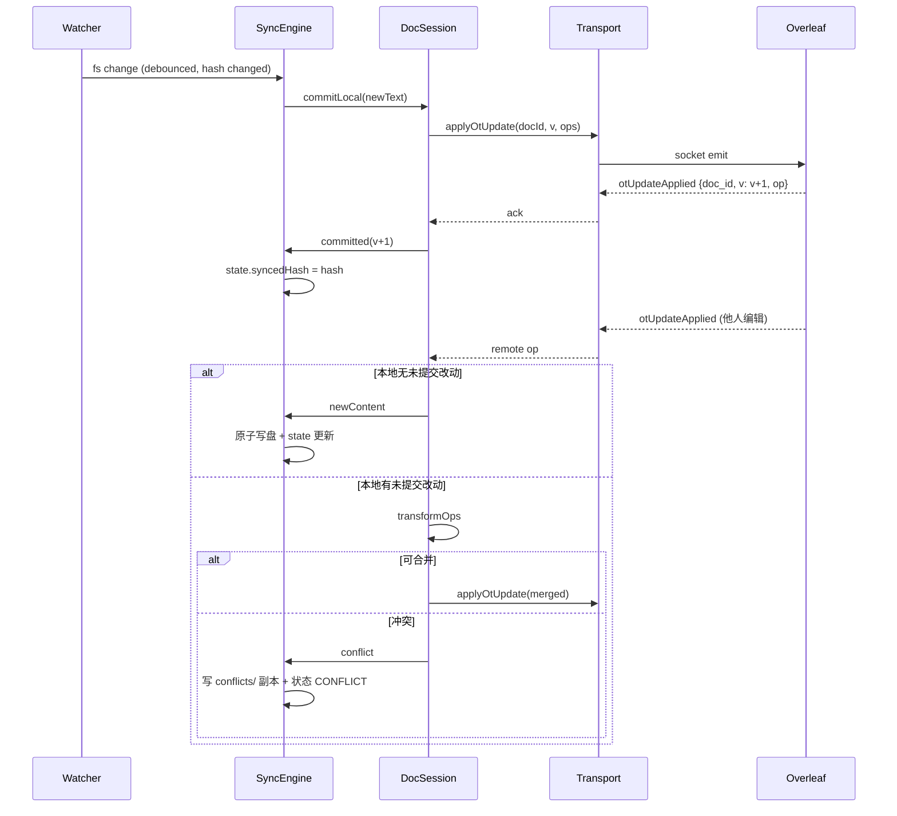

# dsh-overleaf-sync 插件设计文档

> 版本：v0.1（草案，待评审）
> 目标读者：DSH 插件开发者、论文写作类 Agent 的使用者
> 参考实现：[measureer/overleaf-sync](https://github.com/measureer/overleaf-sync)（VS Code 扩展，实测可用的 Overleaf 实时同步方案）

---

## 1. 背景与问题

### 1.1 使用场景

用户在学校/期刊的 Overleaf 项目里写论文，同时希望在本地用 IDE + DSH Agent 做这几件事：

- 用 Agent 做文献整理、章节扩写、公式/图表代码生成、中英文润色；
- 本地跑 `latexmk`/`bibtex` 验证编译，甚至让 Agent 读编译日志改错；
- 用本地 Git 做版本管理（Overleaf 免费版历史版本能力有限）。

现实约束：

| 途径 | 问题 |
| --- | --- |
| Overleaf 官方 Git 集成 | 付费功能（部分学校版有），且是**手动** clone/push/pull，非实时；冲突靠 git merge，对 `.tex` 的大段重排非常不友好 |
| 下载 zip 再上传 | 完全手动，丢失协同上下文，容易覆盖别人正在编辑的版本 |
| 浏览器里复制粘贴 | 无法被 Agent 自动化 |

### 1.2 参考实现的思路（也是本插件的核心思路）

`overleaf-sync` 绕开了 Git，直接使用 Overleaf 网页编辑器背后的**实时协作通道**：

1. 用登录态 Cookie + CSRF token 建立 HTTP 会话；
2. 用 Socket.IO 连到 Overleaf，`joinProject` 拿到项目文件树，`joinDoc` 拿到文档内容与**版本号**；
3. 本地文件变更时，把「旧文本 → 新文本」的差异转成 **OT（Operational Transformation）操作**，通过 `applyOtUpdate` 提交；
4. 远端变更通过 `otUpdateApplied` 事件到达，应用后写回本地磁盘。

这样得到的是**双向、近实时、保留他人协同编辑**的同步，而不是整文件覆盖。本项目沿用这一思路，但落点是 DSH 插件而不是编辑器扩展。

### 1.3 目标 / 非目标

**目标**

- G1 本地目录 ↔ Overleaf 项目的**双向**同步，支持多文档、目录树、二进制附件（图片/PDF/bib 之外的资源）。
- G2 冲突**永不静默覆盖**：冲突时保留双方副本、标记状态、可由 Agent 或用户显式裁决。
- G3 对 DSH Agent 暴露一组 `overleaf_*` 工具，让 Agent 能"看到"项目结构、读到文档、提交修改。
- G4 后台常驻同步服务（watch 模式），Agent 改本地文件即等于改 Overleaf。
- G5 凭据不落项目目录、日志脱敏；写远端操作有明确的审批语义。

**非目标**

- N1 不做 PDF 编译与预览（交给本地 latexmk / 现有 `office-export-pdf` 等能力）。
- N2 不做浏览器 UI 注入或 Playwright 驱动（脆弱、慢；仅作为 SSO 场景的兜底，见 §10.4）。
- N3 不做多人聊天的协作功能（presence 只用于自检与状态展示）。
- N4 不追求 Overleaf 全部特性（评论、track changes、历史版本回滚不在 MVP 范围）。

---

## 2. 参考实现剖析

### 2.1 模块清单与职责

| 模块 | 职责 | 本插件是否沿用 |
| --- | --- | --- |
| `api/base.ts` | HTTP 层：`GET /project` 取 CSRF token、`GET /project/:id/entities` 取文件树、上传文件、cookie 管理 | 沿用，重写为 TS 客户端 |
| `api/socketio.ts` | Socket.IO 层：连接、`joinProject`、`joinDoc`、`applyOtUpdate`、`leaveDoc`、presence，事件封装成 Promise | 沿用（核心） |
| `sync/projectSync.ts` | 项目级同步引擎：文件树映射、并发调度、local/remote 事件分发、冲突策略 | 沿用思路，重写状态机 |
| `sync/docSession.ts` | 文档级会话：缓存 `version + content`，`commitLocal` 提 OT，`applyRemote` 回落 | 沿用，修正版本号乐观递增缺陷 |
| `sync/otDiff.ts` | 文本差异 → OT 操作（`{p, l, r}`） | 沿用思路，换更稳的 diff 实现 |
| `sync/stateStore.ts` | 同步状态持久化（`sha` + `version` + 时间戳），三方比较 | 沿用，**改为项目外存储**（§5.3） |
| `sync/syncManager.ts` | 生命周期：启动/停止/暂停、状态上报、事件 | 沿用，接入 DSH 服务 |
| `sync/ignoreMatcher.ts` | `.overleaf-syncignore` / `.gitignore` 风格忽略 | 沿用并扩展 |
| `config/secretStore.ts` | 凭据持久化（VS Code SecretStorage） | 改造为 DSH 侧 CredentialStore |
| `auth/authFlow.ts` | 从登录页抓 Cookie 与 CSRF | 沿用（取 cookie/token 的部分） |
| `extension.ts` | VS Code 激活、命令注册、状态栏 | 不沿用（换成 DSH 工具 + 服务） |

### 2.2 关键协议事实（来自参考实现，落地前需实测复核）

- **HTTP**：`GET /project/:projectId/entities` 返回文件树；请求需携带 `Cookie: overleaf_session2=…`（旧版 `sharelatex.sid`）与 `X-CSRF-Token`（从 `/project/:id` 页面 `meta[name=ol-csrfToken]` 抓取）。
- **Socket.IO**：`wss://socket.io`，`transport: websocket`，`query` 携带 `projectId` 与 `t`（CSRF token）。
- **`joinProject`** ack：`{ project: { rootFolder: [ { _id, name, docs: [{_id, name}], folders: [...], fileRefs: [...] } ], ... }, protocolVersion }`。
- **`joinDoc`** ack：`[lines: string[], version: number, ops, ranges]`，`lines` 以 `\n` 连接即为文档文本。**不做任何哨兵裁剪**（实现时已按 `.ref/src/sync/docSession.ts:16` 的 `join('\n')` 对齐；若额外 strip 末尾空行，会吃掉以换行结尾文件的最后一个 `\n`）。
- **`applyOtUpdate`**：payload `{ doc, op, v, lastV, meta: { source, ts, user_id? } }`；服务端广播 `otUpdateApplied { doc, v, op, meta }`，`meta.source` 与自身 `publicId` 相同的回声需丢弃。
- **`joinProject`**：v1 直接 `emit('joinProject', { project_id })`，ack 为 `[project, publicId, ...]`；若收到 `connectionRejected` 则回退 v2：URL 带 `?projectId=<id>&t=<csrf>` 并等 `joinProjectResponse`。
- **`leaveDoc`**：`{ doc_id }`，用于释放文档订阅。
- **presence**：`clientTracking.updatePosition`、`clientTracking.clientUpdated`、`clientTracking.getConnectedUsers`、`clientTracking.clientDisconnected`。
- **OT 文本操作**：ShareJS 风格 `{ p: number, l?: string, r?: number }`，`p` 为位置，`l` 为插入文本，`r` 为删除字符数；`applyOtUpdate` 需按版本顺序提交。

> ⚠️ 上述事件名/字段以参考实现为准，本设计把它们收敛到 `transport` 层的一个接口后面（§6.1），实测不一致时只改该层。

### 2.3 已知缺陷与我们的修正

| 参考实现的缺陷 | 后果 | 本设计的修正 |
| --- | --- | --- |
| `commitLocal` 提交后**乐观** `version + 1`，未等 `otUpdateApplied` 的 ack | 连续快速编辑时版本漂移，服务端拒绝后本地状态错乱 | 引入 **per-doc 提交队列**，每次提交等待 ack 的真实 `v` 再更新基线；ack 超时进入 `RESYNC` |
| 只同步"已保存到磁盘"的内容，手动模式下二进制/大文件检测不到 | 漏同步 | 统一 fs 事件 + hash 双通道检测，见 §7.2 |
| 冲突没有无损保留（部分路径覆盖） | 数据丢失风险 | **永不覆盖**：冲突必产出 `*.overleaf-conflict-<ts>` 副本 + 状态机显式 `CONFLICT`（§7.4） |
| 状态文件放在项目内 `.overleaf-sync/` | 会被同步到远端、污染论文目录 | 移到 `~/.dsh/overleaf-sync/projects/<projectId>/`（§5.3） |
| 冲突靠 VS Code 弹窗 | DSH 没有编辑器 UI | 冲突升级为工具 + 事件 + 显式 `overleaf_resolve` |

---

## 3. DSH 插件形态

### 3.1 技术底座

DSH 是 **Cordis 插件体系**（与 Koishi 同源）：插件是一个导出 `apply(ctx)` 的模块，通过 `ctx` 获取服务、注册工具、监听事件、声明副作用。本插件使用到的 ctx 能力：

| 能力 | 用法 | 用途 |
| --- | --- | --- |
| `ctx.tools.register(def)` | 注册 LLM 工具，返回 disposer | 暴露 `overleaf_*` 工具 |
| `ctx.effect(() => dispose)` | 生命周期副作用 | 注册定时器/watcher/socket，插件卸载时自动清理 |
| `ctx.inject([...], cb)` | 依赖注入后再执行 | 等 `tools` / `systemPrompt` / `sessions` 就绪 |
| `ctx.on(...)` | 事件订阅 | 会话结束、工具前后钩子等 |
| `ctx.logger` / 配置服务 | 日志、用户配置 | 调试与配置读取 |

工具定义契约见 §3.2 的入口骨架，这里只列关键约定：

- `execute(args, execution)` 抛出的 `Error` 即工具失败，消息要写成"错误码 + 原因 + 下一步"（§12）；
- `execution.agent?.session?.id` 是会话标识，`execution.signal` 是取消信号（长任务必须响应）；
- 可选的 `presentCall` / `presentResult` 用于 GUI 卡片展示（如"同步中 3 篇文档"），M4 再做；
- 工具注册必须**幂等安全**：插件 reload 时先 `dispose` 再重新注册。

### 3.2 插件入口与工具注册（已在 DSH 0.2.x 现有插件源码中核实）

```ts
// lib/index.ts
import { defineTool } from '@deepseek-ai/dsh-tools'
import z from '@deepseek-ai/schemastery'
import type { Context } from '@deepseek-ai/cordis'

export const name = 'overleaf-sync'
// 模块级 inject：依赖的服务。缺任何一个，插件不会被加载（不会在 apply 里崩）
export const inject = ['tools', 'fs']

// 配置 schema：决定设置页字段与 profile 里 config: 的键；Config 不合法 → 插件不启动
export const Config = z.object({
  baseUrl: z.string().default('https://www.overleaf.com'),
  // 取值：keep-both | keep-local | keep-remote | auto（枚举校验在 apply 里做）
  defaultStrategy: z.string().default('keep-both'),
  watchAutoStart: z.boolean().default(false),
  confirmRemoteWrite: z.boolean().default(true),
  throttleMs: z.number().default(500),
})

export function apply(ctx: Context, config: z.infer<typeof Config>) {
  // register 返回精确 disposer，挂在 effect 上即可随卸载/热重载自动注销
  ctx.effect(() => ctx.tools.register(defineTool({
    name: 'overleaf_status',
    description: '查看 Overleaf 登录态、绑定项目、同步统计与冲突数。',
    // 参数用字段映射 DSL：required 只能写 true，注解键仅 description/title/default/examples
    parameters: {
      project: { type: 'string', description: '项目 id 或项目名；缺省用当前绑定项目' },
      verbose: { type: 'boolean', description: '输出逐文档明细' },
    },
    // output 必须同时给 schema 与 render，缺一即 TypeError
    output: {
      schema: { type: 'string' },
      render: (_args, value) => [{ type: 'text', text: value }],
    },
    timeoutMs: 30_000,   // 协作超时：超时由 TOOL_TIMEOUT 接管
    async execute(args, exec) {
      // exec.agent 可能为 undefined（PTC/后台调用）；exec.agent?.session.id
      // exec.callId / exec.signal / exec.deferContext
      exec.signal.throwIfAborted()
      return '…Markdown 文本…'
    },
  })), 'overleaf-sync: tools')

  // 后台服务（socket / watcher / 定时器）同样交给 effect 托管
  ctx.effect(() => {
    const service = new SyncService(ctx, config)
    return () => service.dispose()
  }, 'overleaf-sync: service')
}
```

要点（实测自 DSH 0.2.1-rc.2 的官方包；完整取证见 [插件 API 笔记](dsh-plugin-api-notes.md)）：

- **形状**：Cordis 对象插件 = 具名导出 `name` / `inject` / `Config` + `apply(ctx, config)`；`inject` 是**模块级服务依赖数组**（`dsh-tool-fs` 用 `['tools','fs','systemPrompt','workingDirectory']`），缺服务则不加载；`ctx.inject(deps, cb)` 是等价的动态写法，用于可选项。
- **可选服务只能 `ctx.get(name)`**：Cordis 对未在 `inject` 里声明的服务做属性访问会抛 `cannot get property "X" without inject`（2026-10-23 实测）。GUI 半侧需要的 `webServer` / `settings` 属可选，模块级 `inject` 仍只声明 `['tools']`；其余一律 `ctx.get()` + 兜底 `try/catch`，`ctx.inject(deps, cb)` 只用于「服务就绪后再注册」的延迟路径。
- **注册/卸载**：`ctx.tools.register(...)` 返回**精确 disposer**（只注销这一个工具）；同层重名与保留名 `run_code` 会抛错。用 `ctx.effect(fn, "label")` 托管，卸载时逆序清理。
- **参数 DSL**（自研，不是 zod）：`string/number/integer/boolean/null/array/object/json` + exact-one `oneOf`；`object` **必须显式给 `additionalProperties: boolean`**；`required` 只能字面 `true`；注解键仅 `description/title/default/examples`，其它键直接报 `is not supported by the value schema DSL`。参数在进 `execute` 前校验，违规是 `ToolArgsError`。
- **output**：`{ schema, render(args, value) }`，`schema` 是权威值，`render` 只产 UI 内容；`presentCall/presentResult` 仅供 Host 本地消费者，Web 端卡片由 `tool.call.toolview` 从 raw args 推导。
- **执行管线**：`tools/pre-execute`（`{kind:'allow'}` 或拦截）→ `ctx.tools.guard()`（单调 deny，后注册不能翻案）→ `tools/execute` → `tools/post-execute`（`{kind:'accept'}`）→ 定义自带 `finalizeContent` → `tools/result`（只读终态）。
- **取消语义**：协作式；派发前取消 → `ABORTED_BEFORE_DISPATCH`，派发后取消 → 用 `ABORTED` 覆盖成功结果，超时 → `TOOL_TIMEOUT`；pull/push 的每个 await 点都要沿 `exec.signal` 传递。
- **错误**：抛 `HarnessError` 子类才会在 `result.error` 里带结构化 `code`，普通 `Error` 只有消息；所以 §12 的错误码要落成 `HarnessError` 子类（具体基类包名在 M0 落实）。
- **两种呈现模式**：`dsh-tools` 的 `mode: native | ptc`。PTC 下模型只直接看到 `run_code`，我们的工具经生成的 SDK 调用——工具必须**无交互、可编程调用**，且 `exec.agent` 可能为空。
- **策略钩子**：硬约束（如"写远端必须 `yes`"）用 `ctx.tools.guard()` 而不是 `execute` 内自查；只读会话可用 `ctx.tools.restrict()` 收窄可见工具。

### 3.3 包结构与安装

```
dsh-overleaf-sync/
├── package.json            # name/version/main/exports（"." -> lib/index.js）
├── cordis.patch.yml        # bundle 默认配置（挂载 id + config 默认值）
├── lib/
│   ├── index.js            # 服务端入口：export const name / export function apply(ctx)
│   ├── client.js           # 浏览器半侧产物（__ModuleLoader__ 形态，见 §14.2；M4）
│   └── skills/*.md         # 可选：随插件分发的操作说明
├── test/                   # 单测 + Mock Overleaf 服务器
└── docs/
    ├── design.md           # 本文档
    └── dsh-plugin-api-notes.md  # 插件契约实测笔记（实现时对照）
```

DSH 的 profile 是"包 + 补丁"结构：

```
~/.dsh/profiles/desktop/
├── package.json            # 依赖列表 + dsh.profile.bundles（有序 bundle 名数组）
├── cordis.patch.yml        # 用户级 patch：- id: <id> + config: / - insert: [...]
├── node_modules/           # 实际安装的插件包
└── cordis.yml              # 根条目表，desktop 上是 []（真正生效靠 patch 叠加）
```

patch 语义（`cordis-plugin-include` / `dsh-app-boot`）：

- 顶层是 YAML 数组；`- id/name/config` 覆盖同 id 条目，**整段替换、不深合并**——所以插件默认值要写在插件自己的 `cordis.patch.yml`（bundle patch）里，用户 patch 只需写差异；
- `- insert: [ {…} ]` 用于新增条目（bundle 挂载自己的插件就走这条）；
- 空 patch 文件会让启动失败，禁用某层要写 `[]`；
- 只有开启 HMR 时改 patch 才热重载，且仅 `.volatile()` 字段能免重启生效；否则装完/改完要重启 DSH。

因此配置的**真源是 profile 里那条插件条目的 `config`**，而不是插件私自维护的配置文件——这与设置页、`plugin_manager` 的写入路径一致，热更新/迁移才有统一出口（§8）。

安装方式：

- 开发期：在 profile 的 `dependencies` 里写 `"dsh-overleaf-sync": "file:C:\\code\\dsh-overleaf-sync"`，`dsh.profile.bundles` 加 `dsh-overleaf-sync`，再 `dsh plugin` 安装/重载；
- 发布期：`dsh plugin add dsh-overleaf-sync@<version>`（确切子命令在 M0 核对 CLI `--help` 后固化）。

包的 `package.json` 关键字段：

```jsonc
{
  "name": "dsh-overleaf-sync",
  "version": "0.1.0",
  "type": "module",
  "main": "lib/index.js",
  "exports": {
    ".": { "default": "./lib/index.js" },
    "./client": { "default": "./lib/client.js" },   // 浏览器半侧，§14.2
    "./package.json": "./package.json"
  },
  "files": ["lib", "cordis.patch.yml", "README.md"],
  "dsh": {
    "manifestVersion": 1,
    "bundle": { "patch": "./cordis.patch.yml" },
    "client": { "platform": "web" }
  },
  "engines": { "dsh": ">=0.2.0-0 <0.3.0-0" },
  "dependencies": { "ws": "^8.18.0" },
  "peerDependencies": { "@deepseek-ai/cordis": "~4.0.5" },
  // M4 客户端半侧再加：react/react-dom ^18.2、@deepseek-ai/dsh-client-ui-slots、-ui-primitives（peer，避免双 React）
}
```

### 3.4 代码组织（`lib/` 内部）

```
src/
├── index.ts               # Cordis 入口
├── config.ts              # 配置 schema 与默认值
├── credentials.ts         # CredentialStore（cookie/csrf）
├── transport/
│   ├── http.ts            # csrf、entities、上传
│   └── socket.ts          # socket.io 封装（事件 → Promise）
├── ot/
│   ├── types.ts           # Op / TextOp / 版本模型
│   ├── diff.ts            # 文本 → OT
│   ├── apply.ts           # OT 应用
│   └── transform.ts       # 并发收敛（本地/远端同时改）
├── core/
│   ├── docSession.ts      # 单文档会话（version + content + 提交队列）
│   ├── syncEngine.ts      # 项目级引擎（树映射、调度、状态机）
│   ├── stateStore.ts      # 基线持久化 + 三方比较
│   ├── ignore.ts          # 忽略规则
│   ├── conflict.ts        # 冲突产物与裁决
│   ├── watcher.ts         # 本地文件监听
│   └── gitInit.ts         # 拉取后自动 git init + 首次提交（§5.8）
├── tools/*.ts             # 每个 overleaf_* 工具一个文件
└── service.ts             # watch 模式后台服务
```

---

## 4. 总体架构

```
                    ┌──────────────────────────────────────────┐
                    │                DSH Agent                  │
                    │   (工具调用 / 系统提示 / 会话事件)          │
                    └───────────────┬──────────────────────────┘
                                    │ ctx.tools.register / ctx.on
┌───────────────────────────────────▼───────────────────────────────────┐
│                          dsh-overleaf-sync                            │
│                                                                       │
│  ┌─────────────┐   ┌──────────────┐   ┌────────────────────────────┐ │
│  │ tools/      │   │ service/     │   │ events (ctx.emit)          │ │
│  │ overleaf_*  │   │ watch 模式    │   │ overleaf/sync, /conflict    │ │
│  └──────┬──────┘   └──────┬───────┘   └────────────▲───────────────┘ │
│         └────────┬────────┘                        │                   │
│          ┌───────▼─────────┐                        │                   │
│          │  SyncEngine     │  (每项目一个，状态机)   │                   │
│          │  ─ DocSession×N  │                        │                   │
│          │  ─ StateStore   │────────────────────────┘                   │
│          │  ─ ConflictMgr  │                                            │
│          └───┬──────────┬──┘                                            │
│              │          │                                               │
│      ┌───────▼──┐   ┌───▼────────┐                                      │
│      │ Watcher  │   │ OtEngine   │  diff/apply/transform               │
│      │ (fs)     │   └───┬────────┘                                      │
│      └──────────┘       │                                               │
│                  ┌──────▼──────────────────────┐                        │
│                  │ transport (http + socket.io) │                        │
│                  └──────────────┬──────────────┘                        │
└─────────────────────────────────┼───────────────────────────────────────┘
                                  │ TLS / wss
                         ┌────────▼────────┐
                         │  Overleaf 服务端 │ (overleaf.com 或自建)
                         └─────────────────┘
```

分层原则：

- **transport** 只关心"怎么和 Overleaf 说话"，不含业务策略；
- **ot** 是纯函数层（可单测、无 IO）；
- **core** 是策略层（版本、冲突、调度）；
- **tools/service** 是对外门面，给 Agent 与用户用。

---

## 5. 关键设计决策（含取舍）

### 5.1 为什么不走 Git，而走实时协作通道

沿用参考实现的判断：Git 桥接需要付费、手动、且对 `.tex` 的结构性改动容易产生大片 diff 冲突；实时通道是增量 OT，他人同时编辑也能自动合并（必要时才降级）。**代价**是要逆向一个非公开协议——所以本设计把协议收敛到 transport 层并配 Mock 服务器测试（§15）。

> 注意区分两件事："**不用 Git 做同步通道**" ≠ "**不用 Git**"。本地副本拉下来后会自动 `git init` 并做一次 import 提交（§5.8），这是给用户自己的版本保险，不参与任何同步判定。

### 5.2 两种运行形态

| 形态 | 触发 | 适用 | 默认 |
| --- | --- | --- | --- |
| **工具模式**（pull/push/diff 按需） | Agent 显式调用 | 一次性同步、只读查阅、审阅远端版本 | 开 |
| **watch 模式**（常驻双向） | `overleaf_watch start` / 会话内配置 | 长时间写作：本地改 → 云端秒级可见 | 关（需显式开启） |

watch 模式按下述规则自动收敛：会话结束（`agent/disposed`）→ 停止 watcher 并 `leaveDoc`；应用退出 → 尽力 flush 一次。

### 5.3 状态落地：项目外存储（对参考实现的偏离）

```
~/.dsh/overleaf-sync/
├── credentials.json         # 0600，cookie + csrf + baseUrl（不进项目）
└── projects/
    └── <projectId>/
        ├── link.json        # 本地目录 ↔ 远端项目绑定关系、同步选项
        ├── state.json       # 每文件基线：remoteVersion / localHash / syncedHash
        ├── conflicts/       # 冲突产物（副本 + 元数据）
        └── journal.ndjson   # 同步审计流水（可关闭）
```

理由：`state.json` 若放在项目目录内，会被同步到 Overleaf，污染论文目录且可能被他人看到；同时 `.gitignore` 参与同步判定会让逻辑变复杂。用 `projectId` 做键，天然支持"一个本地目录 ↔ 多个项目"和"搬动本地目录后重新 link"。

### 5.4 版本一致性：提交等 ack

参考实现乐观 `version+1` 的问题在于：服务端可能因版本不符拒绝，而本地已"以为"成功。本设计：

- `DocSession` 维护 `version`（服务端权威版本）、`localBuffered`（未提交队列）；
- 提交走**串行队列**：`commit` → 等 `otUpdateApplied`（或拒绝）→ 用 ack 中的 `v` 更新；
- 若在等 ack 期间又有本地编辑，先本地暂存，ack 后合并成一次提交（降低频率）；
- ack 超时（默认 8s）→ 文档进入 `RESYNC`：重新 `joinDoc` 全量拉取并按 §7.4 做三方比较。

### 5.5 本地变更检测：fs 事件 + 内容哈希

- 首选 `fs.watch`（Node 内置，Windows 上对目录递归支持良好）；事件 → 300ms 防抖 → 读盘 → 计算哈希。
- 若哈希 == `state.localHash`，忽略（避免编辑器写入临时文件、Agent 重写同内容导致的噪声）。
- 若哈希 == `state.syncedHash` 且 `remoteVersion` 变了，说明只是远端更新回写到磁盘的回环，**必须忽略**（回环抑制，见 §9.3）。
- Agent 通过工具写文件时（未来若提供 `overleaf_write_local`），主动 `notify`，不等 fs 事件。

> 说明：DSH 里的文件写工具（write/edit）本身就会落盘，因此 watch 模式天然能捕获 Agent 的改动；需要额外注意的是"写一半"（分多次 write）造成的中间态——用防抖 + 每次只提交完整文件解决。

### 5.6 冲突裁决模型

- **默认策略 `keep-both`**：本地改 → 写 `foo.tex`；远端也改 → 写 `foo.remote-<ts>.tex`，`foo.tex` 保持本地版，状态 `CONFLICT`。
- `keep-local` / `keep-remote` 可在 link.json 按文件配置（例如 `.bib` 用 remote 优先，正文用 keep-both）。
- 三方合并在**行级**做（`§7.4`）：文件互不重叠的改动区域自动合并；重叠区域才升级为冲突。
- 任一路径都保证：**被覆盖的版本一定能找回**（写盘前先存 `.dsh-bak`）。

### 5.7 与 DSH 的边界

- 插件不自己管会话：工具调用里通过 `exec.agent.session.id` 拿到会话上下文，watch 服务随会话生命周期启停；
- 不 monkey-patch 其他插件；不改 DSH 核心；
- 系统提示注入（可选）：一行状态 `Overleaf: project=xxx, watching=on, 3 docs in sync`，避免 Agent 反复探测。

### 5.8 本地目录约定与自动 Git 初始化（已确认）

**拉取目录**：默认 `~/Overleaf/<项目名>`（`os.homedir()`），可由配置 `localRootPattern` 改写（如 `~/papers/{project}/{date}`）；项目名冲突时加 ` (1)`，`overleaf_link` 可显式传 `localRoot` 覆盖。相对路径一律相对于当前会话工作目录解析，但默认值不是 CWD——避免"插件把论文拉进任意代码仓库"。

**拉取完成后自动建 Git 仓库**（用户已确认，默认开启）：

```
<localRoot>/
├── .git/                      # 若已存在/父目录已是仓库 → 跳过，绝不嵌套
├── .gitignore                 # 插件写入：冲突副本、临时文件
├── .gitattributes             # * text=auto eol=lf —— 避免 Windows CRLF 抖动
└── main.tex …                 # 从 Overleaf 拉下来的文件
```

判定与执行顺序（`core/gitInit.ts`）：

1. `git rev-parse --show-toplevel`：
   - 返回的根 == `localRoot` → 已初始化，只补 `.gitignore`/`.gitattributes` 中缺失条目；
   - 返回的是**父目录**（用户已把论文放在某个仓库里）→ **不初始化**，只在 `link.json` 记 `git: { mode: "parent", root }` 并提示；
2. 目标目录已有 `.git` 但 `git rev-parse` 失败（损坏/权限）→ 跳过并报 `E_GIT_BROKEN`，不猜测不删除；
3. 无仓库 → `git init -b main` → 写 `.gitignore` / `.gitattributes` → `git add -A` → 首次提交；
4. 首次提交用 `-c user.name=… -c user.email=…` 兜底（取 `git config user.name/email`，都没有则 `dsh-overleaf-sync` / `noreply@localhost`），**不修改用户的全局 git 配置**；
5. 提交信息：`chore: import "<项目名>" from Overleaf (<projectId> @<timestamp>)`；`link.json` 记 `initialCommit`。

边界与安全：

- **Git 只是本地便利，不参与同步协议**（与 §5.1 不冲突：我们不用 Git 桥接，但用户当然可以给自己的本地副本打版本）。
- 默认**不**在每次同步后自动提交（`git.autoCommit: false`）——否则用户的历史会被 Agent 的每次 push 灌满；可开启，提交消息带 `overleaf-sync` 前缀便于过滤。
- `git` 不存在或初始化失败**绝不阻断同步**：拉取已成功，只降级为"无仓库"并回 `E_GIT_UNAVAILABLE` / `E_GIT_INIT_FAILED` 警告；`overleaf_pull` 的返回里明确写"已拉取，未建仓库（原因）"。
- `.gitignore` 默认内容：`*.LOCAL.*`、`*.REMOTE.*`、`*.merge.*`、`.dsh-bak/`、`*.sync-conflict.*`；用户已有 `.gitignore` 时**追加而非覆盖**（带 `# dsh-overleaf-sync` 段标记）。
- 状态目录（§5.3）在项目外，因此不会被 `git add` 进去；凭据更不会。
- 提交前做一次大小检查：单文件 > 20MB 或文件数 > 2000 时只 `git add` 文本类（`*.tex/*.bib/*.cls/*.sty/*.md`），避免把论文里的图片/PDF 一次性塞进仓库——需要全量时用户可手动 `git add -A`。

---

## 6. 模块设计

### 6.1 transport

```ts
interface OverleafTransport {
  connect(cfg): Promise<void>
  joinProject(): Promise<ProjectTree>
  joinDoc(docId): Promise<{ lines: string[]; version: number }>
  leaveDoc(docId): Promise<void>
  applyOtUpdate(docId: string, version: number, op: TextOp[]): Promise<{ v: number }>
  uploadFile(path: string, data: Buffer): Promise<{ fileRefId: string }>  // 阶段 M3
  on(event: 'otUpdateApplied' | 'disconnected' | 'reconnected' | 'clientUpdated', cb): Unsubscribe
  close(): Promise<void>
}
```

- 实现：`http.ts` 负责 CSRF/文件树/上传，`socket.ts` 用 `socket.io-client`（`transports: ['websocket']`，`reconnection: true`，指数退避）。
- **出网方式**：DSH 的服务清单里**没有** `http` 服务，插件跑在 Node 主进程，直接用全局 `fetch`（Node 22 内置）+ `ws`/`socket.io-client` 依赖出网；不需要也不应该绕 `webServer`（那是给 GUI 用的入站路由）。因此 `package.json` 里 `socket.io-client`、`ws` 是**运行时依赖**，且不得依赖任何 Electron 专有 API。
- 所有 socket ack 一律包成 `Promise` + 超时（默认 10s）+ `exec.signal` 中断。
- **不允许**把 Overleaf 内部字段泄漏到 core 层：`joinDoc` 返回的 `ops`、`ranges` 一律丢弃，只取 `lines` 与 `version`。

### 6.2 ot

纯函数模块（无 IO、可 100% 单测）：

- `diffToOps(oldText, newText): TextOp[]`：字符级 diff（选 `fast-diff`，~2KB，MIT）→ 合并相邻同类操作 → `{p,l,r}` 序列；diff 规模超过阈值（默认 2 万字符变更）时退化为 `[{p:0, r: old.length}, {p:0, l: newText}]`（单次全量替换，仍在同一 OT 语义内）。
- `applyOps(text, ops)`：本地校验用（应用后必须等于目标文本）。
- `transformOps(local, remote)`：并发收敛；本地/远端改动互不相交时正确合并，相交时返回 `conflict: true`。
- `normalizeOps`：合并相邻 retain/insert/delete，去掉空操作。

不变量（测试硬性断言）：
1. `applyOps(old, diffToOps(old, new)) === new`；
2. `diffToOps` 只产生单调递增的 `p`；
3. `transformOps` 对互不相交的改动满足交换律。

### 6.3 core.docSession

```ts
class DocSession {
  readonly docId: string
  private version: number        // 服务端权威
  private content: string        // 本地视角的远端内容（不含未提交改动）
  private pending: string[]      // 未提交的本地文本快照队列
  private queue: Promise<void>   // 串行提交队列
  private state: 'IDLE'|'SENDING'|'RESYNC'|'ERROR'

  async open(): Promise<void>
  async commitLocal(nextText: string): Promise<CommitResult>  // 可能返回 conflict
  onRemoteUpdate(v: number, ops: TextOp[]): Promise<RemoteApplyResult>
  async resync(): Promise<void>
  async close(): Promise<void>
}
```

`commitLocal` 流程：

1. 若 `nextText === content` → 无事发生；
2. 入队；计算 `ops = diffToOps(content, nextText)`；
3. `applyOtUpdate(docId, version, ops)`（携带当前 version）；
4. ack 返回 `v` → `content = nextText; version = v`；
5. 若服务端拒绝（版本不符）→ `resync()` 后按 §7.4 处理，返回 `conflict` 给上层。

### 6.4 core.syncEngine

项目级，职责：

- 启动：`joinProject` → 建目录 → 按策略拉取文档（MVP 全量）→ 建立基线（`StateStore`）；
- 树映射：`tree[overleafPath] ↔ localPath`，冲突命名规则（同名后缀 ` (1)`）；
- 调度：本地事件 → 找 `DocSession`（懒打开）→ `commitLocal`；远端事件 → 找本地文件 → 写入；
- 状态机（见 §9.1）、冻结/恢复（`pause`/`resume`，暂停时保留 socket 以接住远端更新，但只入队不写盘）；
- 统计：`{ synced, pending, conflicts, errors }` 供 `overleaf_status` 展示。

### 6.5 core.stateStore

`state.json`：

```jsonc
{
  "schemaVersion": 1,
  "projectId": "64f…",
  "localRoot": "D:/papers/xxx",
  "updatedAt": "2026-10-22T21:30:00+08:00",
  "files": {
    "main.tex": {
      "docId": "64f…9a",
      "remoteVersion": 137,
      "remoteHash": "sha256:…",   // 上次见到的远端内容
      "localHash":  "sha256:…",    // 上次同步时本地内容
      "syncedAt":   "2026-10-22T21:29:58+08:00",
      "origin": "remote"           // local | remote | both
    }
  },
  "filesMissing": { "old/chapter.tex": { "docId": "…", "deletedAt": "…" } }
}
```

三方比较（`changedLocal` / `changedRemote`）只看三个值：`当前磁盘哈希`、`localHash`、`remoteVersion vs 当前远端版本`。这正是参考实现 `stateStore` 的思路，只是存储位置与字段更严格。

### 6.6 core.ignore

优先级从高到低：

1. `.overleaf-syncignore`（项目内，与参考实现同名，降低迁移成本）；
2. link.json 的 `exclude` 数组；
3. 内置默认：`.git/`、`.dsh-*/`、`*.tmp`、`*.swp`、`.DS_Store`、`node_modules/`、`*.pdf`（可选，见 §8 二进制）。

语义与 `.gitignore` 对齐（支持 `!` 取反、目录尾斜杠、`**`），但**不做跨层忽略**：只忽略匹配到的文件，保留空目录（Overleaf 空目录本身不承载内容）。

### 6.7 core.watcher

- 按项目根目录递归监听；`fs.watch` + `stat` 去抖（单文件 300ms，批量 1.5s）；
- 忽略自身写入（写前登记 `inFlightWrites`，写完 500ms 内的事件丢弃）；
- 与 Overleaf 侧 tree 变化（远端新增/删除文件）协同：本地删除 → `applyOtUpdate` 空文档 + 忽略（MVP 不删远端文件，只标记 `filesMissing`，避免误删他人内容）。

### 6.8 core.conflict

- 产物：`conflicts/<ts>/<path>.local`、`<path>.remote`、`meta.json`（版本、时间、策略、hash）；
- 主文件保留策略由 link.json 决定（默认本地）；
- 记录到 `state.json.conflicts`，`overleaf_status` 与 `overleaf_conflicts` 工具可查；
- `overleaf_resolve` 支持 `keep_local | keep_remote | merge`（merge 走三方行级合并）。

### 6.9 credentials

```ts
interface Credential {
  baseUrl: string          // https://www.overleaf.com 或自建
  cookie: string           // overleaf_session2=...
  csrfToken: string
  userHint?: string        // 例如邮箱前缀，仅展示
  savedAt: string
}
```

- 存储：`~/.dsh/overleaf-sync/credentials.json`，权限 0600（Windows 上放在 `%USERPROFILE%` 下并依赖用户目录 ACL）。
- **不提供账号密码登录**：2FA / 企业 SSO / 风控验证码无法自动化。获取方式：
  1. 用户在浏览器登录 Overleaf → 开发者工具 → 复制 `Cookie` 与 `meta` 中的 CSRF；`overleaf_login` 工具接收粘贴的 cookie（工具描述里明确"不要把密码给模型"）；
  2. 可选便利功能：从本机 Chromium/Chrome profile 读取 cookie（需用户显式授权，类似浏览器 MCP 的做法），列为 M4。
- 过期处理：请求 401/403 → 清 token、状态 `AUTH_EXPIRED`、工具返回明确指引。

---

## 7. 同步算法

### 7.1 启动（pull → baseline → watch）

```
1  connect()                    // cookie + csrf 校验，失败 → AUTH_ERROR
2  joinProject()                // 项目树
3  for each doc in tree (受 ignore 与 include 限制):
      joinDoc(docId) → {lines, version}
      若本地不存在          → 写盘（原子：tmp + rename），baseline = 远端
      若本地存在且哈希相同   → baseline = 远端（视为已同步）
      若本地存在且哈希不同   → 三方比较（§7.4）→ 可能 CONFLICT
4  写 state.json
5  gitInit.ensure(localRoot, {enabled: cfg.git.autoInit})   // §5.8；失败只警告
6  if watch 模式 → watcher.start()
```

`gitInit` 放在第 5 步的理由：只有"全量拉取成功"之后建仓库，首次提交才是一份干净的完整快照；拉取中途失败不留半成品仓库。

### 7.2 本地 → 远端

```
fs 事件(防抖) → 读文件 → hash 比较
  ├─ 与 localHash 相同 → 丢弃（噪声）
  ├─ 与 syncedHash 相同 → 丢弃（回环）
  └─ 真变更 → DocSession.commitLocal(nextText)
        ├─ 成功(a ck.v) → 更新 state（remoteVersion=v, syncedHash=hash）
        └─ 冲突/拒绝    → resync + ConflictResolver
```

提交节流：同一文档 500ms 内多次变更合并为一次（取最后内容），**不**逐次提交 OT，避免版本抖动。

### 7.3 远端 → 本地

```
on(otUpdateApplied {doc_id, v, op})
  → 找 DocSession；若未打开（未关注的文档）→ 只更新 state.files[x].remoteVersion（懒处理）
  → 打开时：applyOps(content, op) 得 newContent
       ├─ 本地无未提交改动 → 原子写盘；state.remoteVersion=v, syncedHash=hash
       └─ 本地有未提交改动 → transformOps(localOps, remoteOps)
              ├─ 可合并 → 提交合并结果（先本地落盘再 push）
              └─ 相交   → CONFLICT：写副本、暂停该文档同步、上报
```

### 7.4 三方比较与合并（`merge3`）

输入：`base`（上次同步内容，取 `remoteHash` 对应缓存或磁盘备份）、`local`、`remote`。
实现：行级 diff（`diff` 包 `diffLines` / 自研 Myers），把 base→local 与 base→remote 的变更区域并集化；无重叠区域直接采用，重叠区域判冲突。

输出：

```ts
type MergeResult =
  | { kind: 'merged'; text: string; regions: number }
  | { kind: 'conflict'; text: string; conflicts: Array<{ from: number; to: number; local: string; remote: string }> }
```

冲突时的 `text` 用标记块包住双方（沿用 git 风格，但便于 Agent 阅读）：

```
<<<<<<< local (v138, 2026-10-22 21:31)
本地段落
=======
远端段落
>>>>>>> overleaf (v141, 2026-10-22 21:33)
```

> `.tex` 的"行级"合并对公式/段落重排仍可能误判——所以默认不自动提交 `text`，只作为 `foo.tex.merge` 参考文件并置 `CONFLICT`，由 Agent/用户确认。

### 7.5 掉队与重连

- socket 断开：状态 → `OFFLINE`，本地改动**照常写盘**，只入队（`pendingEdits`），不尝试提交；
- 重连：`joinProject` → 对每个 `pendingEdits` 的文档 `joinDoc` 校验版本：
  - 版本未变 → 直接提交；
  - 版本变了 → 三方比较（§7.4）；
- 应用关闭：尝试 flush（最多 5s），失败则保持 `pendingEdits` 持久化，下次启动先做 §7.4。

### 7.6 二进制与附件（M3）

- 远端 `fileRefs`（图片/`.pdf`/`.bib` 之外的附件）走 HTTP 上传接口；下载走 `file/:id` 直链。
- MVP 只**下载**（只读落盘），上传功能默认关闭（覆盖他人附件风险高）。
- 二进制文件不参与 diff：变更即全量替换，并记录 hash。

---

## 8. 配置

`link.json`（每项目）：

```jsonc
{
  "schemaVersion": 1,
  "projectId": "64f…",
  "localRoot": "C:/Users/me/Overleaf/毕业论文",
  "include": ["**/*.tex", "**/*.bib", "figures/**"],
  "exclude": ["**/*.pdf", ".git/**"],
  "strategy": "auto",              // auto | keep-local | keep-remote | keep-both
  "autoPush": true,                // 工具模式下是否自动提交（false 则只 diff）
  "throttleMs": 500,
  "binary": "download-only",       // off | download-only | bidirectional
  "git": {
    "mode": "own",                 // own（本目录新建）| parent（已属于上层仓库）| none（跳过）
    "root": "C:/Users/me/Overleaf/毕业论文",
    "initialCommit": "a1b2c3d",
    "initializedAt": "2026-10-22T22:10:00+08:00",
    "autoCommit": false
  }
}
```

`~/.dsh/profiles/<profile>/cordis.patch.yml` 中的插件条目（**全局配置真源**）：

```yaml
- id: overleaf-sync
  config:
    baseUrl: https://www.overleaf.com
    localRootPattern: "~/Overleaf/{project}"   # 默认拉取目录（§5.8）
    defaultStrategy: keep-both
    watch:
      autoStart: false
      idleLeaveDocMs: 60000
      maxOpenDocs: 20
    git:
      autoInit: true               # 拉取后自动建仓库（用户已确认）
      autoCommit: false            # 每次同步后自动提交（默认关，避免刷历史）
      initialCommitMessage: 'chore: import "{project}" from Overleaf'
      includeBinaryInFirstCommit: false
    journal:
      enabled: true
      keepDays: 7
    confirmRemoteWrite: true
    debug: false
```

```jsonc
// 等价的 JSON 视图（默认值）
{
  "baseUrl": "https://www.overleaf.com",
  "localRootPattern": "~/Overleaf/{project}",
  "defaultStrategy": "keep-both",
  "watch": { "autoStart": false, "idleLeaveDocMs": 60000, "maxOpenDocs": 20 },
  "git": {
    "autoInit": true,
    "autoCommit": false,
    "initialCommitMessage": "chore: import \"{project}\" from Overleaf",
    "includeBinaryInFirstCommit": false
  },
  "journal": { "enabled": true, "keepDays": 7 },
  "confirmRemoteWrite": true,
  "debug": false
}
```

配置来源与职责划分：

| 位置 | 内容 | 谁写 |
| --- | --- | --- |
| profile 插件条目 `config` | 全局行为（baseUrl、默认策略、watch 参数） | 用户/设置页/插件工具（经配置服务） |
| `~/.dsh/overleaf-sync/credentials.json` | cookie/CSRF，**绝不进 profile** | `overleaf_login` 工具 |
| `~/.dsh/overleaf-sync/projects/<id>/link.json` | 目录绑定与 per-file 策略、include/exclude | `overleaf_link` 工具 |
| 项目内 `.overleaf-syncignore` | 该项目的忽略规则 | 用户 |

配置变更：订阅配置变化事件后重建 SyncEngine（不重连 socket，仅更新 throttle/策略）；需要重启的项（baseUrl）给出明确提示。凭据变更一律重新握手。

**GUI 写入路径**：设置页不是第二个真源，它通过 `settings.update(ns, patch, expectedRevision)` 写回**同一条** profile 条目（`ns` = profile 里的插件行 id，不是包名），字段↔控件映射见 §14.3.3。凭据、`link.json` 这两类**不**走配置通道（§6.9）。

**patch 语义提醒**（DSH 0.2.x 实测）：`- id/name/config` 是**整段替换**，不深合并；所以上面这条用户级条目一旦写了 `config:`，就必须写全所有非默认字段，否则其余字段回落到插件 `cordis.patch.yml` 里的 bundle 默认值（这是设计上要保留的"默认值只有一处"原则）。另外：同一 profile 里空 patch 文件会导致启动失败，禁用该层要写 `[]`；未开启 HMR 时改配置需重启；只有标了 `.volatile()` 的字段能热生效。

---

## 9. 状态机与不变量

### 9.1 同步状态机

```
        ┌──────────┐  connect+join ok
        │  OFFLINE │───────────────┐
        └────┬─────┘               ▼
   断线/重连  │                ┌─────────┐   pull 完成   ┌──────────┐
             └───────────────►│ SYNCING │──────────────►│  WATCHING │
                              └────┬────┘◄──────────────└────┬─────┘
                                   │ 冲突/版本漂移               │ pause
                                   ▼                            ▼
                              ┌──────────┐              ┌──────────┐
                              │ CONFLICT │              │  PAUSED  │
                              └────┬─────┘              └──────────┘
                                   │ resolve
                                   └──────────► SYNCING
```

规则：

- `CONFLICT` 只冻结**冲突文档**，其它文档继续同步；
- `PAUSED` 停写盘与提交，但仍接收远端更新并记录（保证恢复后能收敛）；
- 任何状态转换都写 journal（`journal.ndjson`）。

### 9.2 不变量（实现时硬性保证）

1. 任何时刻本地磁盘内容 = `applyOps(base, pendingOps)`，不存在"半应用"（原子写：`tmp` + `rename`）。
2. 提交的 `version` 必须等于当前 `DocSession.version`（由串行队列保证）。
3. 覆盖任何文件前，若该文件 `syncedHash !== 当前 hash`，必须在 `conflicts/` 或 `.dsh-bak` 留副本。
4. `pendingEdits` 与 `state.json` 在进程内一致：写入磁盘前先落 state，失败则回滚内存视图。

### 9.3 回环抑制

`remote → 磁盘` 写入时：登记 `inFlightWrites[path]=hash`，Watcher 回调命中则丢弃；写完后把 `state.syncedHash` 更新为同一 hash。这是最容易出 bug 的地方，单测必须覆盖（§15）。

---

## 10. 工具接口（对 Agent 暴露）

命名统一前缀 `overleaf_`，全部返回 Markdown 文本（`output.schema: string`）。

| 工具 | 用途 | 关键参数 | 副作用 |
| --- | --- | --- | --- |
| `overleaf_status` | 登录态、绑定项目、同步统计、冲突数、watch 状态 | `verbose?` | 无 |
| `overleaf_login` | 保存用户粘贴的 cookie/csrf，或清理凭据 | `cookie`, `csrfToken`, `baseUrl?`, `clear?` | 写全局凭据 |
| `overleaf_projects` | 列出/搜索可访问项目 | `query?`, `limit?` | 无（只读） |
| `overleaf_link` | 绑定本地目录 ↔ 项目，生成 link.json | `projectId`, `localRoot?`（默认 `~/Overleaf/<项目名>`）, `strategy?`, `include?`, `exclude?` | 写 link.json |
| `overleaf_pull` | 远端 → 本地（按文档过滤）；成功后按 §5.8 自动建仓库 | `docs?`, `force?`, `dryRun?`, `gitInit?`（默认 true） | 写本地文件、可能 `git init` |
| `overleaf_push` | 本地 → 远端（默认 dryRun） | `paths?`, `dryRun?`（默认 true）, `yes?` | 写远端（需确认） |
| `overleaf_diff` | 三方对比：本地 / 基线 / 远端 | `path`, `format?: 'summary'\|'unified'` | 无 |
| `overleaf_watch` | 启动/停止后台双向同步 | `action: 'start'\|'stop'\|'status'` | 启动服务、socket |
| `overleaf_conflicts` | 列出冲突及建议动作 | — | 无 |
| `overleaf_resolve` | 裁决冲突 | `path`, `choice: 'keep_local'\|'keep_remote'\|'merge'`, `yes?` | 写本地/远端 |

设计要点：

- **默认落地目录**：`~/Overleaf/<项目名>`（配置 `localRootPattern` 可改）；`overleaf_pull` 未绑定项目时**不猜**——先要求 `overleaf_link`，避免把论文拉进当前代码仓库。
- **拉取成功即建 Git 仓库**（`git.autoInit: true`），但初始化失败只警告、不回滚拉取；`overleaf_status` 里显示 `git: own@<短 sha> / parent / none`。
- **后台 watch 默认关闭**（`watch.autoStart: false`），必须显式 `overleaf_watch start` 或配置打开。
- **写远端默认需要 `yes: true` 或全局 `confirmRemoteWrite: false`**：Agent 可以 diff，但不该"顺手"覆盖别人正在编辑的论文章节。
- 所有工具 `exec.signal` 必须响应取消（socket 请求带 AbortSignal）。
- 错误统一格式：`错误码 + 一句话原因 + 下一步建议`（E_* 见 §12）。
- 文本里避免贴整篇 `.tex`（大文件截断到 200 行 + `overleaf_diff` 引导），防止把上下文打爆。

### 10.1 与 Agent 写作流程的配合（示例）

```
用户：把第 3 章的方法部分改写得更简洁，并同步到 Overleaf
1. overleaf_status                     → project=xxx, watch=off
2. overleaf_pull                       → 拉到 ~/Overleaf/<项目名>，并 git init + 首次提交
3. （本地 edit 工具改 chapter3.tex）
4. overleaf_diff path=chapter3.tex     → 远端未变，可安全推送
5. overleaf_push paths=[chapter3.tex] yes=true
   → 提交 OT，导师在 Overleaf 里实时看到改动
   （本地仓库此时是 dirty 状态；是否提交由用户决定，插件不自动 commit）
```

### 10.2 审批与安全边界

- 工具层只做"能力"，是否自动批准由 DSH 的审批机制决定；
- 若需要**不可被绕过的**硬约束（例如没带 `yes` 一律不许写远端），在插件里用 `ctx.tools.guard()` 注册单调守卫，而不是靠 `execute` 里的自查或模型自觉；
- 需要**停下来问用户**时用 `ctx.approval.request({…})`：它只能在开着的 turn 内调用，policy 只有 `ask` / `never`（`never` 时会直接拒绝，不弹窗），结果只有 `allowed-once / rejected / cancelled / unavailable`，**没有"总是允许"**——所以插件必须自己 fail-closed，并把"拒绝"翻译成可读的错误；
- 沙箱类放宽（如写项目外目录）沿用 `sandbox_permissions` + `justification` 参数与 `approveEscalation(...)`，拒绝码 `FS_SANDBOX_DENIED`；本插件正常不应触发它（见 §5.3 状态目录在项目外，但要由用户显式授权路径）；
- `overleaf_login` 拒绝接收密码字段（schema 里就没有），只收 cookie；
- 日志中不打印 cookie 值，只打印 `overleaf_session2=***`。

---

## 11. 数据流（时序）



---

## 12. 失败模式与降级

实现约定：下表 `E_*` 全部落成 **`HarnessError` 子类**（带结构化 `code`）——普通 `Error` 只会在 `result.error` 里留下消息，模型与 UI 都读不到码；每个码在 README 里配一句人话解释 + 下一步动作。

| 场景 | 检测 | 处理 | 用户可见 |
| --- | --- | --- | --- |
| 未配置/未登录 | 无凭据 | 工具返回指引，状态 `AUTH_REQUIRED` | `E_AUTH_REQUIRED` |
| cookie 过期 | 401/403 | 清 token、状态 `AUTH_EXPIRED` | `E_AUTH_EXPIRED` |
| 项目不存在/无权限 | joinProject 报错 | 直接失败，不改本地文件 | `E_PROJECT_FORBIDDEN` |
| 文档在远端被删 | 树里消失 | 本地文件保留，标记 `filesMissing`；不删除 | 状态里提示 |
| 版本漂移/掉队 | ack 拒绝或 `v` 跳变 | `resync` + 三方比较 | 可能触发 CONFLICT |
| OT 合并失败 | transform 抛错 | 降级：全量替换（本地或远端优先按策略）+ 冲突副本 | `E_OT_FALLBACK` |
| socket 抖动 | disconnect 事件 | 指数退避重连，本地改动入队 | 状态 `OFFLINE` |
| 同名本地/远端差异文件 | 树映射冲突 | 远端名加后缀 ` (1)`，不覆盖 | 日志/状态 |
| 大文件（>2MB 文本） | 大小检查 | 拒绝 OT，走"全量上传 + 提示"或跳过 | `E_TOO_LARGE` |
| 并发多人编辑同段 | transform 相交 | CONFLICT + `.merge` 参考稿 | `E_CONFLICT` |
| 免费版限流 | 429/超时 | 退避 + 降低提交频率 | 状态提示 |
| 本地磁盘只读/权限 | fs 错误 | 立即停同步，避免"以为同步了" | `E_LOCAL_IO` |
| 未安装 git | `git --version` 失败 | 跳过仓库初始化，继续同步 | `E_GIT_UNAVAILABLE`（警告） |
| git init/commit 失败 | 非零退出码 | 不回滚已拉取文件，记录原因 | `E_GIT_INIT_FAILED`（警告） |
| 目录内已有损坏 `.git` | `rev-parse` 失败 | 不删除、不猜测，提示用户处理 | `E_GIT_BROKEN` |
| 项目被改名/迁移 | 树刷新 | 重新映射，保留 state（按 docId 匹配） | 日志 |
| 粘贴的 cookie 无效（GUI/工具登录） | `whoami` 失败或 401 | 不写凭据，提示重新复制 | `E_AUTH_INVALID` |
| 绑定目录不可用（不存在/只读/在项目外） | Host 侧路径校验 | 拒绝绑定，返回具体原因 | `E_LOCAL_DIR_INVALID` |
| 设置页写回撞上并发修改 | `settings.update` 的 `expectedRevision` 不匹配 | 不覆盖，要求刷新后重试 | `E_SETTINGS_CONFLICT`（HTTP 409） |
| 服务器用 socket.io 0.9 老协议 | 握手探测命中 `sid:hb:close:transports` | 切 legacy 传输层（见 §12.1） | 自动，不打扰用户 |

### 12.1 服务器代际差异：socket.io v4 与 v0.9

overleaf.com 与新的社区版走 **socket.io v4 / Engine.IO v4**；不少国内自建实例（含
`latex.cstcloud.cn`，服务端分发的客户端是 `Socket.IO.min.js build:0.9.17-overleaf-5`）
仍是 **socket.io 0.9**。两者在线上协议层完全不兼容：v4 客户端连 0.9 服务端时，
握手阶段就失败，`io()` 永远不产生 `connect`，于是我们看到的症状是
「`joinProject` did not answer within 15000 ms」——**报的是超时，坏的是协议**。

区分办法（一次只读探测，不依赖任何第三方包）：

| 探测 | v4 服务器 | 0.9 服务器 |
| --- | --- | --- |
| `GET <base>/socket.io/?EIO=4&transport=polling` | `0{"sid":…}` | `Welcome to socket.io.`（静态欢迎文本） |
| `GET <base>/socket.io/1/?projectId=<id>&t=<ms>` | 404 / 非该形态 | `sid:60:60:websocket,xhr-polling` |
| `GET <base>/socket.io/socket.io.js` | 现代构建 | `build:0.9.17-overleaf-5` |

0.9 路线的实测要点（已在该站跑通，协议细节见 [legacy-socket.md](legacy-socket.md)）：

1. 握手 URL **必须带 `projectId`**：`/socket.io/1/?projectId=<id>&t=<ms>`，返回 `sid:60:60:websocket,xhr-polling`；
2. 升级到 `wss://<host>/socket.io/1/websocket/<sid>`，请求头带同一个 Cookie 与 `Origin`；
3. 升级成功后**服务端自动**发 `1::` 并直接推 `joinProjectResponse`（该 fork 既不要客户端发 `joinProject`，也不用 ack 回数据），每 join 一次换一个新 `publicId`；客户端按「先吃自动推送、再回落标准流程」实现，两种形态都能完成；
4. `joinDoc` / `applyOtUpdate` 走 0.9 的 ack 帧 `6:::<id>+[args]`：`joinDoc` 的 ack 是 **6 元素** `[null, string[] lines, version, [], {}, 'sharejs-text-ot']`，行是**数组**（不是拼接字符串），单帧可达 ~98 KB（64 位长度路径）；
5. 心跳：服务端 `hb=60`，60 s 无流量即断；客户端 20 s 发一次 `2::` 只是保险，实测不发也能撑过 45 s；
6. 该站约 **1/4 的 upgrade 会被 `7:::1+0`（`client not handshaken` / advice `reconnect`）拒掉，但 sid 仍然有效**——必须同 sid 重试（≤4 次、75 ms 间隔），再退回重新握手；且**同一项目同一账号只允许一个 socket**，用户浏览器开着该项目时插件连不上，这是服务端限制而非插件缺陷；
7. 实现：`src/transport/legacy.ts`（零新依赖，纯 `node:https` + `node:crypto` 手写 RFC6455，含同 sid 重试、自动 join、心跳、ack 表、`AbortSignal` 预算）+ `src/transport/legacyTransport.ts`（把这些映射到 `OverleafTransport` 的 `joinProject/joinDoc/leaveDoc/applyOtUpdate/onRemoteUpdate/close`）；`src/transport/index.ts` 的 `createTransport` 先 `detectSocketProtocol()` 探测，再选对应实现，并给 legacy 路线加 90 s 总预算（超时给出「关闭浏览器里该项目的标签页后重试」的提示）。

---

## 13. 可观测性

- `journal.ndjson`：`{ts, event, docId?, path?, v?, ms, ok, code?}`，默认保留 7 天；
- 环境变量：`DSH_OVERLEAF_DEBUG=1`（打印 socket 出入站，凭据脱敏）、`DSH_OVERLEAF_TRACE_OT=1`（打印 op）；
- `overleaf_status` 输出：连接状态、项目、文件数、待同步、冲突、最近错误、watch 状态；
- GUI 呈现见 §14：设置页承载一次性配置，右侧边栏面板承载运行状态与 pull/push（M4a/M4b）。

---

## 14. GUI：设置页与侧边栏（M4）

> 本节依据 [客户端 UI 契约调研](client-ui-notes.md) 写成，其中每个 API 形状都有 `文件:行号` 证据；没有证据的能力一律标「无证据」，不设计依赖它的功能。

### 14.1 分工：GUI 给人，工具给 Agent

| 层 | 谁用 | 适合放什么 | 不适合放什么 |
| --- | --- | --- | --- |
| 工具（`overleaf_*`） | Agent / 脚本 | 批量、可编程、结构化返回值 | 危险动作的人为确认、路径浏览 |
| 设置页（`settings.section`） | 人，一次性配置 | 登录态、项目绑定、目录、策略、git/watch 选项 | 高频状态刷新 |
| 侧边栏面板（右侧 tab） | 人，运行时 | 当前状态、Pull/Push、冲突列表、日志尾巴 | 长表单、配置编辑 |
| 工具卡片（`tool.call.toolview`） | 人，随对话 | 单次 pull/push 的摘要卡片 | 全局状态 |

两条铁律：

1. **客户端不持有权威状态**。浏览器半侧是纯沙箱（无 `fs`、无 Node、只能同源 `fetch`），且 HMR 重载会丢掉全部 React state（`client-ui-notes.md` §7.4）。因此面板上的一切数字都必须能在重挂载后从 Host 重新拉到；客户端只做渲染与触发。
2. **危险动作必须人能看见**。Agent 调 `overleaf_push` 受 `confirmRemoteWrite` 约束；GUI 上的真写还要额外一次二次确认（§14.5）。

### 14.2 客户端插件形态

`package.json` 增加（与 Node 半侧并列，`client-ui-notes.md` §1、§6）：

```jsonc
{
  "exports": {
    ".": { "types": "./lib/index.d.ts", "default": "./lib/index.js" },
    "./client": { "types": "./lib/types/client/index.d.ts", "default": "./lib/client.js" },
    "./package.json": "./package.json"
  },
  "dsh": {
    "bundle": { "patch": "./cordis.patch.yml" },
    "client": { "platform": "web" }   // 入口只由 exports["./client"] 决定，没有 entry 字段
  },
  "files": ["lib", "cordis.patch.yml", "README.md"]
}
```

- 入口形状与 Node 侧同构：`export const inject = [...]` + `export function apply(ctx)`；产物**不是 ESM**，而是 `window.__ModuleLoader__.load({ id: "dsh-overleaf-sync", factory: (require) => … })`（tsdown 生成）。
- externals 固定 7 个：`react`、`react/jsx-runtime`、`react-dom`、`react-dom/client`、`cordis`、`@deepseek-ai/dsh-client-ui-slots`、`@deepseek-ai/dsh-client-ui-primitives`；这些只写 **peerDependencies**，避免双 React。
- 首帧成本：client 入口保持极轻（只注册 slot 与拉一次 status），重组件（diff 视图、日志滚动）用 `require.async` 拆 chunk。
- **必须自带 RenderBoundary**：框架不兜底渲染异常，一个 tab 崩掉会让整块侧边栏白屏（`client-ui-notes.md` §7.3）。做两级：ROOT（保住 shell）+ PER-TAB（只坏一个面板）。
- `inject` 漏写即白屏级故障（Cordis 会抛 `cannot get property … without inject`），取服务一律走 inject，或在 `try/catch` 里降级。

```ts
// src/client/index.tsx
export const inject = ['slots', 'sessions', 'locale', 'sidebarRightTabs', 'sidebarRight']
export function apply(ctx: Context) {
  ctx.effect(() => registerSettingsPage(ctx), 'overleaf: settings page')
  ctx.effect(() => registerSidebarTab(ctx), 'overleaf: sidebar tab')
}
```

### 14.3 设置页

#### 14.3.1 为什么自绘，而不是让 Config 自动生成表单

插件 Config 有 schemastery schema 时，DSH 会自动在 Settings→Plugins 生成表单——但本插件有三件事自动表单做不到：

1. **凭据不能进配置**。profile 的 `config:` 是明文 YAML，cookie 写进去等于落盘泄密（与 §6.9 的凭据存储原则冲突）。设置页需要「输入即写凭据中心、之后只显示状态」的控件。
2. **项目绑定是动作不是配置**。要从远端拉项目列表、要校验本地目录、要触发首次 pull。
3. **状态管理要能点**。同步状态、冲突列表、立即 pull/push 都不属于配置项。

因此采用 `configure({ auto: false }, ctx.fiber)` 关掉自动表单，全部自绘（`client-ui-notes.md` §2，`dsh-settings/README.md:39`）。**配置真源仍是 profile 里那条插件条目的 `config`**（§8），设置页只是它的可视化编辑器；headless 场景照旧改 YAML。

#### 14.3.2 注册

```ts
ctx.slots.inject('settings.section', () => ctx.slots.register({
  name: 'settings.section',
  id: 'overleaf-sync',
  order: 120,
  label: () => t('overleaf.settings.nav'),   // “Overleaf 同步”
  inject: () => ({ api, t }),
}, OverleafSettingsSection))
```

组件签名用 `PropsRuntime<'settings.section'>`，并 `import type {} from '@deepseek-ai/dsh-client-ui-settings/client'` 合并 SlotMap（`client-ui-notes.md` §2）。

#### 14.3.3 页面结构与字段映射

```
┌ Overleaf 同步 ─────────────────────────────────────────┐
│ ① 账号                                                 │
│   ● 已保存凭据 · hint · 10-23 12:30  [重新登录] [退出]  │
│   Cookie  [••••••••（已设置）]  CSRF [••••]  [登录]     │
│ ② 项目与目录                                            │
│   项目 [arXiv 模板 ▾] [刷新]    本地目录 [~/Overleaf/… ]│
│                                   [校验路径] [用默认]   │
│   绑定后：远端 42 个文件 · 上次拉取 2 小时前            │
│ ③ 同步策略                                              │
│   冲突处理  (•) 保留双方 ( ) 本地优先 ( ) 远端优先      │
│   写远端前确认 [开]     拉取后建 git 仓库 [开]          │
│ ④ 高级（折叠）                                          │
│   baseUrl / watch.* / journal.keepDays / debug          │
│                                            [保存修改]   │
└────────────────────────────────────────────────────────┘
```

| 区块 | 控件 | 落点 | 键 / 接口 | 说明 |
| --- | --- | --- | --- | --- |
| ① 账号 | 状态徽章 | 只读 | `POST /overleaf/api/status` → `credential.hint` | 过期显示 `E_AUTH_EXPIRED` 徽章 |
| ① 账号 | Cookie / CSRF 输入 | 写凭据 | `POST /overleaf/api/login` | 提交后立即清空输入框，只回显「已设置」 |
| ① 账号 | 退出 | 写凭据 | `POST /overleaf/api/logout` | 二次确认 |
| ② 项目 | 项目下拉 | 只读远端 | `POST /overleaf/api/projects` | 名称 + 最后修改时间 |
| ② 项目 | 本地目录 | 动作 | `POST /overleaf/api/pick-directory` → `link` | 「选择目录」拉起系统「浏览文件夹」对话框：优先用宿主 `ctx.directoryPicker` 的 `native` 能力；若该 seam 被第三方插件切成 `browse`（DSH Desktop 上 `dsh-remote-web` 会这样做，以便手机端也能选目录），Windows 宿主改用插件自带的 PowerShell `FolderBrowserDialog` 兜底；两者都没有时降级为手动输入 + `validate-path`。页面加载时先 `probe`，据此决定显示「选择目录」还是「校验路径」 |
| ③ 同步 | 拉取 / 推送 / 预演 | 动作 | `POST /overleaf/api/pull` · `/push` | **绑定只登记配对，不拉文件**：绑定成功后提示「点拉取」，由用户显式触发首次下载。理由见 §14.6.2；之后「拉取」「推送预演」「推送」（真写需二次确认，送 `confirm: true`）。watch 未实现，故文案明确写「后台自动监听尚未启用」，避免用户空等 |
| ② 项目 | 默认目录 | 动作 | 同上，`localRoot` 省略 | 按 `localRootPattern` 展开 |
| ③ 策略 | 单选 / 开关 | 配置 | `defaultStrategy`、`confirmRemoteWrite`、`git.autoInit`、`git.initialCommitMessage` | 与 `Config` 一一对应 |
| ④ 高级 | 数值 / 文本 | 配置 | `baseUrl`、`watch.*`、`journal.*`、`debug` | 默认折叠，减少误改 |

> 所有接口一律 `POST` + JSON（含只读的 `status`/`projects`）：同源 `fetch` 无需处理
> CORS 预检差异，路由实现也只有一条代码路径。信封与错误码见 `docs/m4a-api-contract.md`。

#### 14.3.3.1 为什么「绑定」不顺手拉取

早期实现点完「绑定」会紧接着自动发一次 `pull`，把首拉的结果一起报出来。用户实测后要求改掉
（m02525）。三条理由：

1. **语义混淆**：绑定 = 登记「远端项目 ↔ 本地目录」这一对关系，是**零风险、瞬时**的；拉取会写本地磁盘、可能覆盖已有文件、耗时取决于网络。两件事合在一起，任何一侧出错都只能笼统报「绑定失败」。
2. **失败噪音**：自建服务器可能在 socket 层就不可达（见 §12.1），自动首拉会让「绑定成功」这件事被一次超时掩盖，用户看到的是错误而不是已经建立好的配对。
3. **可预期性**：用户按下什么就发生什么。绑定后提示「点拉取开始下载」，把决定权交回用户；`pull` 也仍然可以单独重试，不需要重新绑定。

因此 `link` 只写 `link.json`，客户端绑定成功后只弹一条提示，不发任何拉取请求。

#### 14.3.4 目录选择：没有原生选择器，用「输入 + 服务端校验」

调研未找到 DSH 客户端提供原生目录选择器的证据（`client-ui-notes.md` 附录）。因此 v1 的做法是：

- 文本输入框（默认值由 `localRootPattern` 在 Host 侧展开，如 `~/Overleaf/<项目名>`）；
- 「校验路径」按钮 → `POST /overleaf/api/validate-path`，Host 侧检查：可展开、非符号链接逃逸、可写、是否为空目录、是否已是其它项目的绑定目录；
- 返回 `{ ok, resolved, problems[] }`，`resolved` 回填输入框（让用户看到最终绝对路径）；
- 若路径已存在且有文件：显示「将覆盖 N 个文件」并要求勾选确认（避免误绑已有目录）。

#### 14.3.5 凭据的特殊处理

- Cookie/CSRF **永不写进 profile config，也永不回传浏览器**。`settings.describe({ redactSecrets: true })` 对机密字段只给「已设置」标记（`dsh-client-ui-settings/README.md:49`），设置页据此显示 `••••`。
- 输入框是**写入型**：提交成功后清空，不保留在组件 state 里。
- 登录成功后 Host 只保存凭据并返回 `{ baseUrl, hint? }`（Overleaf 的 `whoami` 不保证给邮箱，**不编造 email**）；设置页显示「已保存凭据 · hint · 保存时间」；`E_AUTH_EXPIRED` 时徽章变红并提供「重新登录」。
- 与工具一致：`overleaf_login` 的 schema 里也没有密码字段——GUI 同样不提供密码登录。

#### 14.3.6 保存语义

- **显式保存**（页面底部「保存修改」），不做逐字段自动保存：配置有跨字段约束（如 `watch.autoStart` 依赖已登录 + 已绑定），半保存状态会让插件进入无法解释的中间态。
- 保存带 `expectedRevision`；Host 侧 `settings.update(ns, patch, expectedRevision)` 冲突时抛 `SettingsConflictError` → 路由映射 **409** → 页面提示「配置已在别处修改，刷新后重试」，**绝不覆盖**。
- 保存成功后若需要重载才生效（watch 参数），页面顶部显示「部分改动在下次同步时生效」提示，不静默。

### 14.4 侧边栏面板

#### 14.4.1 注册：只走原生右侧栏，better-sidebar 留作可选增强

```ts
// 平台保证的入口：注册一个 tab 类型 + 它的 body slot（两段式，key 必须一致）
const stopType = ctx.sidebarRightTabs.register({
  id: 'overleaf-sync',
  kind: 'overleaf-sync',
  title: () => t('overleaf.tab.title'),
  priority: 'extension',
})

const stopBody = ctx.slots.inject('sidebar.right.pane.tab', () => ctx.slots.register({
  name: 'sidebar.right.pane.tab',
  key: 'overleaf-sync',
  inject: (sessionId: string) => ({ sessionId, api, t }),
}, OverleafPanel))

return () => { stopBody?.(); stopType?.() }   // 两段成对回滚
```

**为什么不优先 `ctx.betterSidebar.registerTab`**：它是第三方插件提供的便利服务，装了才有、版本会漂移，而且它会**自动为每个注册类型生成一个原生 tab 类型**——若我们同时注册原生类型，用户会看到两个 Overleaf tab；只依赖它则没装 better-sidebar 的用户什么都看不到。所以 v1 只调平台原生 API（`sidebarRightTabs` + `sidebar.right.pane.tab`），把 better-sidebar 集成放到 M4c 作为可选增强（届时用 `ctx.inject(['betterSidebar'], …)` 且**不再**注册原生类型）。

左侧栏**不占**：Overleaf 是项目级工具，语义上属于「右侧 IDE 区」，且左侧 `sidebar.panellist` 选中不存在的 `main` 会抛错（`client-ui-notes.md` §3）。右侧也没有 pane 级 action 槽或折叠态控件槽，所以所有动作都放在 tab body 内部。

#### 14.4.2 信息架构

```
┌ Overleaf ──────────────────── ● 已连接 ┐
│ arXiv 模板            [↻]  [设置]      │
│ ───────────────────────────────────── │
│ 状态   ● 已同步 · 42 个文件             │
│ 远端   v128 · 2 小时前                  │
│ 本地   3 个改动待推 · 0 个冲突          │
│ ───────────────────────────────────── │
│ [ Pull ]  [ Push (dry-run) ]  [ 打开目录 ] │
│ ───────────────────────────────────── │
│ 冲突 (2)                    [全部打开] │
│  ⚠ main.tex        remote-2026…         │
│  ⚠ refs.bib        remote-2026…         │
│ ───────────────────────────────────── │
│ 日志                                    │
│ 21:04 pull 42 files ok                  │
│ 20:58 push 3 docs ok                    │
└─────────────────────────────────────────┘
```

- 状态徽章用 `StateDot` + `Pill`（`已同步` / `同步中` / `有冲突` / `未连接` / `未登录`）。
- 动作按钮用 `Button`；图标统一 `Icon*Regular`；日志区用等宽 `TerminalBlock` 或 `<pre>`。
- 列表自己 `map`——primitives 里没有 Table/List 组件（`client-ui-notes.md` §4）。

#### 14.4.3 会话与项目的关系

右侧栏布局本身按 `sessionId` 存（平台行为），但**同步状态是项目级的**：一个 profile 同时只绑定一个「当前项目」（§9.1 状态机）。因此面板约定：

- 面板在哪个会话打开都显示**同一个**当前绑定项目，数据同源、靠事件广播更新；
- 未来若支持多项目并行，再把 `sessionId → projectId` 映射加进来（面板 `inject(sessionId)` 已经预留了这个入参）；
- 无绑定项目时显示空态：引导去设置页绑定，或直接内嵌「从远端选项目」下拉。

#### 14.4.4 动作与确认

| 动作 | 前置校验 | 确认 | 结果呈现 |
| --- | --- | --- | --- |
| Pull | 已登录 + 已绑定 | 本地有未推改动时二次确认（会保留冲突副本） | 进度条 → 摘要（N 个文件 / 冲突 M 个） |
| Push (dry-run) | 已登录 + 已绑定 | 不需要 | 变更清单（文件 + op 数） |
| Push（真写） | dry-run 已完成 | **必须二次确认**，且 Host 侧仍检查 `confirmRemoteWrite` | 逐文档结果，失败的文档列出错误码 |
| 打开目录 | 已绑定 | 不需要 | 走平台 `openWorkspacePath`；无此能力时复制路径并 toast |

#### 14.4.5 更新机制：SSE + 降级轮询

- Host 侧开 `GET /overleaf/events`（SSE），事件帧只带**失效通知 + seq**（学 better-sidebar 的 sidechat 推送：帧不带大 payload，客户端凭 `afterSeq` 重拉，`client-ui-notes.md` §5.3）。
- 事件类型：`status`（状态变化）、`progress`（pull/push 进度）、`conflict`（新增冲突）、`auth-expired`、`reloaded`。
- 客户端：`EventSource` 断线指数退避 1s→15s；`document.visibilityState === 'hidden'` 时断开，恢复可见时重连并带 `afterSeq` 补拉。
- 若 SSE 三次重连失败：降级为 10s 轮询 `status`，面板顶部显示「实时更新不可用」。

### 14.5 Host 侧接口（客户端唯一通道）

第三方插件不能注册 `ctx.remote` 命名空间（`client-ui-notes.md` §5，无证据支持），所以 Node 半侧自建同源路由，客户端用 `fetch` 调（与 better-sidebar 的 `/sidebar/api/<method>` 同构）：

| 方法 | 请求 | 返回 | 错误码 |
| --- | --- | --- | --- |
| `status` | `{}` | `StatusSummary` | — |
| `login` | `{ cookie, csrf? }` | `{ ok, baseUrl, hint? }` | `E_AUTH_INVALID` |
| `logout` | `{}` | `{ ok }` | — |
| `projects` | `{ refresh? }` | `ProjectListEntry[]` | `E_AUTH_EXPIRED` |
| `link` | `{ projectId, localRoot? }` | `LinkRecord` | `E_LOCAL_DIR_INVALID`、`E_PROJECT_NOT_FOUND` |
| `validate-path` | `{ path, projectId? }` | `{ ok, resolved, problems[] }` | — |
| `pull` | `{ projectId?, force? }` | `PullSummary` | `E_CONFLICT`、`E_TRANSPORT` |
| `push` | `{ projectId?, dryRun }` | `PushSummary` | `E_CONFLICT`、`E_AUTH_EXPIRED` |
| `diff` | `{ projectId?, path? }` | `DiffSummary` | — |
| `conflicts` | `{}` | `ConflictEntry[]` | — |
| `journal` | `{ limit }` | `JournalEntry[]` | — |
| `settings.describe` | `{}` | `{ fields, revision }` | — |
| `settings.update` | `{ patch, expectedRevision }` | `{ fields, revision }` | `settings-conflict`(409)、`settings-rejected`(400) |

约定：

- 全部 `POST` + JSON，同源，带 `AbortSignal` 取消；路由层校验 `Origin`/`Sec-Fetch-Site` 同源，拒绝跨站（防 CSRF）。
- 返回信封 `{ ok: true, value }` / `{ ok: false, code, message, hint? }`，`code` 与工具错误码同一套（§12 的 `E_*` 表）。
- `sessionId` 由客户端附带、Host 只用于日志与后续多项目路由，**不用于鉴权**（鉴权仍是平台会话 + 凭据中心）。
- 路由只做参数校验与错误映射，业务逻辑一律复用 `OverleafSyncService`（与工具同一份实现，禁止平行逻辑）。

### 14.6 安全边界

| 面 | 约束 |
| --- | --- |
| 凭据 | 只在 Host 侧；不出现在 config、不返回客户端、日志脱敏 |
| 路径 | `localRoot` 必须经 Host 侧 `realpath` + 越界校验（不得写出用户主目录之外的隐式路径，显式绝对路径需确认） |
| 写远端 | GUI 二次确认 + Host 侧 `confirmRemoteWrite` 双保险 |
| 跨站 | 路由同源校验；不提供 GET 副作用接口 |
| 注入 | 所有远端文本（项目名、文件名）渲染时转义；日志块不解析 HTML |

### 14.7 构建与测试

- 构建：`tsdown` 双入口（Node `lib/index.js`、浏览器 `lib/client.js`），`build = "tsc -p tsconfig.build.json && tsdown"`；`pnpm run dev:web` 下 HMR 热更。
- 体积预算：`lib/client.js` < 150 KB（gzip 后 < 45 KB）；超了就把 diff 视图拆 chunk。
- 测试：
  - 组件测试：Node 侧 `renderToString` 快照（空态/已同步/冲突/未登录/凭据过期五态）；
  - 路由测试：对 `/overleaf/api/*` 用真实 service + 假 transport，断言错误码映射与 409 冲突；
  - 手动 E2E 清单：装插件 → 设置页填 cookie → 选项目 → 校验目录 → 绑定 → 面板 pull → 本地改 → 面板 dry-run → 真写 → 制造冲突看列表。

### 14.8 里程碑拆分

| 阶段 | 内容 | 验收 |
| --- | --- | --- |
| M4a 设置页 | 自建 `/overleaf/api/settings.*` + 账号/项目/目录/策略四区块 + 显式保存与 409 | 能在 GUI 里完成「登录 → 选项目 → 绑定 → 改策略并保存」，重启后配置仍在 |
| M4b 侧边栏 | 右侧 tab（原生两段式注册）+ 状态/动作/冲突/日志 + SSE | 面板 pull/push 与工具结果一致；断网重连后状态自愈；冲突实时出现 |
| M4c 打磨 | 工具卡片（`tool.call.toolview`）、审计日志视图、多项目预留 | — |

---

## 15. 测试策略

### 15.1 单元（无网络）

- `ot/diff`：随机文本对 500 组，断言 `applyOps(old, diffToOps(old,new)) === new`；
- `ot/transform`：互不相交/相交用例，交换律与幂等；
- `core/stateStore`：三方比较真值表（本地改/远端改/都改/都没改）；
- `core/ignore`：`.gitignore` 语义用例集；
- `core/conflict`：merge3 的重叠/非重叠区域，`.tex` 段落重排样例；
- `core/gitInit`（临时目录 + 真 git，CI 有 git 时跑）：
  - 空目录 → `git init -b main` + 首次提交成功，`git status` 干净；
  - 已在上层仓库内 → `mode: "parent"`，不产生嵌套 `.git`；
  - 已有 `.git` → 不重复初始化、不动用户历史；
  - `git` 不在 PATH（mock spawn 失败）→ 返回警告且不抛错；
  - 无 `user.name/email` → 用 `-c` 兜底提交成功，且 `git config --global` 未被改写。

### 15.2 集成（Mock Overleaf）

自建一个 socket.io 服务模拟 `joinProject/joinDoc/applyOtUpdate/otUpdateApplied` + 一个内存版文档仓库（含版本号与 op 历史）。测试：

1. 单客户端：本地改 → 远端版本 +1；
2. 双客户端：A 本地改、B 远端改（不相交）→ 双方收敛到同一文本；
3. 双客户端相交改动 → 触发 CONFLICT 且无数据丢失；
4. 断线重连：离线期间本地多次改 → 重连后一次性收敛；
5. 回环抑制：远端更新写盘后不得再次触发提交（断言 applyOtUpdate 调用次数）。

### 15.3 端到端（真实 Overleaf，手动/条件触发）

- 用测试账号 + 测试项目（自己或导师授权的项目）；
- 验收藏点：中文 `.tex`（UTF-8、CRLF 混用）、含 `\input` 的多文件、图目录、`.bib`；
- 并发编辑用两个浏览器标签模拟。

### 15.4 验收标准（MVP）

- [ ] 只读：`overleaf_projects` + `overleaf_pull` 能把项目完整拉到本地（含子文件夹），默认落在 `~/Overleaf/<项目名>`。
- [ ] 仓库：首次 `overleaf_pull` 成功后目录里出现 `.git`，`git log` 有一条 import 提交，`git status` 干净；已在上层仓库内时不新建嵌套仓库。
- [ ] 写入：本地改一行 → 500ms~2s 内在 Overleaf 编辑器可见。
- [ ] 协同：两人同时改不同段落，双方都不丢改动。
- [ ] 冲突：同时改同一段，本地出现冲突副本，主文件不被静默覆盖，`overleaf_conflicts` 可见。
- [ ] 断网 30s 期间多次编辑，恢复后 10s 内收敛且无重复提交。
- [ ] watch 停止/会话结束不留孤儿 socket（进程退出干净）。

---

## 16. 里程碑

| 阶段 | 内容 | 产出 | 预估 |
| --- | --- | --- | --- |
| M0 调研 | 协议实测（cookie/csrf、事件名、op 格式）、Mock 服务器搭建 | 调研笔记 + Mock | 2 人日 |
| M1 只读 | transport + `overleaf_projects/pull/status/login` + 默认目录 `~/Overleaf/<项目名>` + 拉取后 `git init` 首次提交（§5.8） | 能拉取项目并留下一份干净的本地仓库 | 3 人日 |
| M2 双向 | ot 模块 + DocSession + push + watch | 本地改→云端可见 | 5 人日 |
| M3 稳健 | 冲突/掉队/重连/二进制下载/状态机完善 | 验收 §15.4 | 5 人日 |
| M4a 设置页 | `dsh.client` 清单 + tsdown 双入口 + `settings.section` 页 + 自建 `/overleaf/api/settings.*`（§14.3） | 可在 GUI 完成登录/绑定/策略保存 | 2 人日 |
| M4b 侧边栏 | 右侧 tab（原生两段式注册）+ 状态/动作/冲突/日志 + SSE（§14.4/14.5） | 面板与工具结果一致、断网自愈 | 3 人日 |
| M4c 打磨 | 工具卡片（`tool.call.toolview`）、better-sidebar 可选集成、系统提示注入、配置热更新、日志审计视图 | 可发布 | 2 人日 |

M0 的产出里还应固化三件实现层面的“钉死项”：`HarnessError` 基类的真实包名、`dsh plugin add` 的确切子命令（见 [插件 API 笔记](dsh-plugin-api-notes.md) §9/§10），以及客户端半的构建方式——已由 [客户端 UI 调研](client-ui-notes.md) §1 回答：**需要构建**，`exports["./client"]` + `dsh.client.platform: "web"`，产物是 `window.__ModuleLoader__.load({ id, factory })` 而非 ESM。

风险缓冲：协议逆向若与假设不符（overleaf.com 版本差异），M0 可能 +2 人日，且 M2 需要重做 transport 层——因此 transport 接口必须先冻结（§6.1）。

---

## 17. 风险与开放问题

1. **协议非公开**：Overleaf 升级可能改名事件/字段。缓解：transport 抽象 + 版本探测（`joinProject` 返回的 `protocolVersion` 记录在状态里，异常时提示"可能不兼容"）。
2. **合规**：使用非官方通道可能违反 Overleaf 使用条款；建议在文档里明确"仅用于自己有权编辑的项目"，并提示学校的 Overleaf 服务条款差异。
3. **多人协同的"礼貌性"**：Agent 自动改写大段内容会让导师困惑；默认 `confirmRemoteWrite=true`，并提供 `overleaf_push --dryRun` 的 diff 预览。
4. **`.tex` 合并质量**：行级合并不理解 LaTeX 结构，跨行重排会误报冲突。开放问题：是否引入"段落级 + 结构感知"合并（按 `\section` 切块）作为 M4 增强？
5. **是否需要 `overleaf_edit`（不落盘直接改远端文档）**：对 agent 更直接，但绕过本地基线会放大冲突。倾向 M4 后评估。
6. **凭据读取浏览器 cookie 的合规与安全**：涉及用户隐私，必须显式授权 + 仅限 overleaf 域，M4 前不做。
7. **Windows 路径与大小写**：Overleaf 路径大小写敏感、Windows 不敏感，映射冲突要在 link 阶段提示。
8. **审批不可用时的降级**：若会话审批 policy 是 `never`（自动拒绝，不弹窗），`confirmRemoteWrite=true` 会把 push 卡死。设计上必须把"审批被拒"当成普通失败返回（`E_APPROVAL_DENIED` + 建议 `confirmRemoteWrite:false` 或改在允许审批的会话里操作），而不是让工具挂起。
9. **自动建仓库的副作用**：`git init` 会把整个项目目录变成仓库——若用户原本打算在别处建仓库、或目录里已有大文件（PDF/图片），首次 `add -A` 可能很慢。缓解：默认只 add 文本类（§5.8）、`git.autoInit` 可关、且**已属于上层仓库时绝不嵌套**。另：自动提交只在初始化时发生一次，`git.autoCommit` 默认关。

---

## 附录 A：参考实现 ↔ 本插件对照

| 参考实现 | 本插件 | 说明 |
| --- | --- | --- |
| `api/base.ts` | `transport/http.ts` | 同类，TS 重写 |
| `api/socketio.ts` | `transport/socket.ts` | 同类，事件 Promise 化 |
| `sync/docSession.ts` | `core/docSession.ts` | 修版本 ack 缺陷 |
| `sync/otDiff.ts` | `ot/diff.ts` | 换 diff 实现，加不变量测试 |
| `sync/projectSync.ts` | `core/syncEngine.ts` | 状态机重写 |
| `sync/stateStore.ts` | `core/stateStore.ts` | 移到项目外 |
| `sync/ignoreMatcher.ts` | `core/ignore.ts` | 扩展 include |
| `sync/syncManager.ts` | `service.ts` | 挂到 Cordis 生命周期 |
| `config/secretStore.ts` | `credentials.ts` | cookie 粘贴，不做密码登录 |
| `extension.ts` | `tools/*` + `ctx` 注册 | 从编辑器命令改为 LLM 工具 |

## 附录 B：OT 操作示例

文档 `notes.tex` 当前内容 `"ABC\nDEF"`（version 12）。

- 本地把 `DEF` 改成 `DEX`：`diffToOps` → `[{ p: 6, r: 1, l: 'X' }]`（位置 6 删除 1 个字符、插入 `X`）；
- 远端同时在某处插入：`[{ p: 1, l: 'Z' }]`；
- 两 op 位置不相交 → `transformOps` 可直接合并成 `[{p:1,l:'Z'}, {p:7,r:1,l:'X'}]`（位置随插入后移）；
- 若两 op 覆盖同一区间 → 返回 `conflict: true`，走 §7.4。

> 具体 `p/l/r` 字段名与语义以 `transport` 实测为准（ShareJS 风格 `{p, l, r}`，`r` 为删除长度）。

## 附录 C：端点/事件速查

| 类型 | 名称 | 备注 |
| --- | --- | --- |
| HTTP | `GET /project/:id` | 页面含 CSRF meta 与 `ol-usersEmail` |
| HTTP | `GET /project/:id/entities` | 文件树 JSON（实现改用 socket 快照，见 §3.4） |
| HTTP | `GET /project/:id/file/:fileId` | 二进制附件下载 |
| HTTP | `GET /user/projects` | 项目列表（`_id` → `id`） |
| Socket | `joinProject` | v1 ack `[project, publicId, …]`；v2 等 `joinProjectResponse` |
| Socket | `joinDoc` | `[lines, version, ops, ranges]`（不 strip 哨兵） |
| Socket | `applyOtUpdate` | `{ doc, op, v, lastV, meta }` |
| Socket | `otUpdateApplied` | `{ doc, v, op, meta }`，按 `meta.source` 过滤回声 |
| Socket | `leaveDoc` | `{ doc_id }`（或 doc id） |
| Socket | `clientTracking.*` | presence |

## 附录 D：实现状态（M1/M2 已落地）

| 设计章节 | 落地文件 | 状态 |
| --- | --- | --- |
| §3.2 入口 | `src/index.ts` | ✅ `name` / `inject` / `Config` / `apply`，`ctx.effect` 注册 8 个工具 |
| §9 配置 | `src/config.ts`、`cordis.patch.yml` | ✅ 12 个配置键（含 `volatile()` 隐藏项） |
| §3.3 打包 | `package.json`（`dsh.bundle.patch`）、`tsconfig.json` | ✅ `tsc` 输出 `lib/`（ESM） |
| §5 本地目录 | `src/core/paths.ts`、`src/core/fsUtil.ts`、`src/service.ts`（`resolveLocalRoot`） | ✅ `~/Overleaf/<项目名>`，含越界校验 |
| §5.8 git | `src/core/gitInit.ts` | ✅ own/parent 判定、首次提交带 `-c user.name/email` 兜底 |
| §6.1 transport | `src/transport/{socket,http,packed,credentials,index}.ts` | ✅ REST + Socket.IO + OT 编码 |
| §6.2 docSession | 并入 `src/service.ts`（每文档 baseVersion/baseline 随 `state.json` 持久化） | ✅ 等价实现，未单独建类 |
| §6.3 OT diff | `src/core/otDiff.ts` | ✅ `diffToOps` / `applyOps` / `transformOps` |
| §6.5 状态 | `src/core/stateStore.ts` | ✅ `~/.dsh/overleaf-sync/projects/<id>/state.json` |
| §6.6 忽略 | `src/core/ignore.ts` | ✅ `.gitignore` / `.overleaf-syncignore` 语义 |
| §13 可观测性 | `src/core/journal.ts` | ✅ 审计流水（凭据脱敏） |
| §7.3 pull | `src/service.ts` `pull()` | ✅ 全量下载 + baseline + 自动 git init |
| §7.3 push | `src/service.ts` `push()` | ✅ 默认 dry-run，逐文档 OT 提交，不覆盖冲突 |
| §7.4 冲突 | `src/service.ts` `pull()` | ✅ 远端写 `*.remote-<ts>.<ext>`，本地保留 |
| §10 工具 | `src/tools/index.ts`（`createOverleafTools`）+ `src/index.ts` 注册 | ✅ status/login/logout/projects/link/pull/push/diff |
| §7.2 watch | — | ⏳ M3 |
| §10 `overleaf_resolve` | — | ⏳ M3 |
| §14 GUI：设置页 | `src/server/*` + `src/client/*` + `locale/*` | ✅ M4a（Host API + 设置页，重启 DSH 后可见；实现说明见 [m4a-api-contract.md](m4a-api-contract.md)） |
| §14 GUI：侧边栏 | — | ⏳ M4b（原生两段式注册 + SSE，设计见 §14.4/14.5） |

测试：`test/{core,transport,service,plugin}/` 共 **92 个用例**（`node --test 'test/**/*.test.mjs'`，需先 `tsc` 构建）。

> 协议事实以 `src/transport/` 的实测实现为准：与附录 C 的旧描述冲突处，一律以本附录上一节（§2.2 已同步修正）为准。

